
<a href="https://ilyomix.github.io"></a> <a href="https://ilyomix.github.io"></a>

<!-- The projects as one card, in four bands that touch thanks to align="top": the heading and LED Board come
from the build, Cadran (live downloads, real-time Titan clock) and Lift (real-time lock screen) from api/.
Only what is live comes from api/: the visitor counter and the two devices. Each sits on one line with the static
rest of its band, which arrives with the page, shows the card and holds the line's height, so the live piece fills
a slot that is already there. No whitespace between pieces on a line, and no piece much taller than wide (see
DEVICE_LIVE in profile/build.py). ?v=2 asks api/ for these shapes. -->

<a name="projects">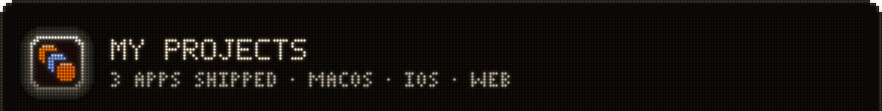</a> <a href="https://cadranapp.com">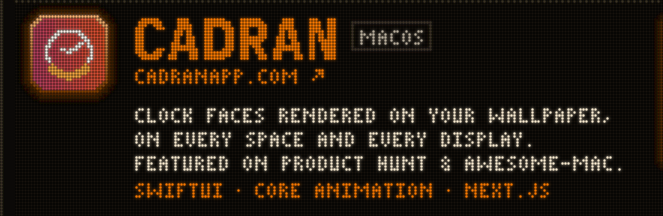</a> <a href="https://apps.apple.com/app/id6818697874">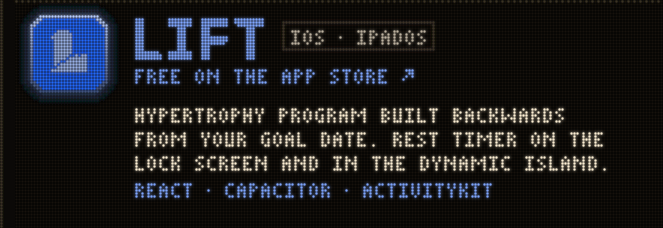</a> <a href="https://crypto-led-board.vercel.app/">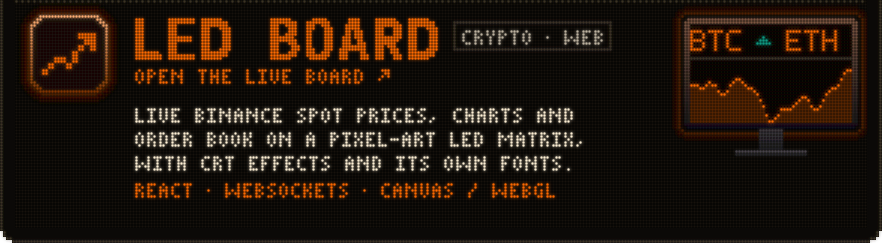</a>

<!-- An anchor around an image keeps GitHub from wrapping it in a link to itself, so the card isn't clickable.
A bare <a> won't do: GitHub strips it. -->
<a name="github">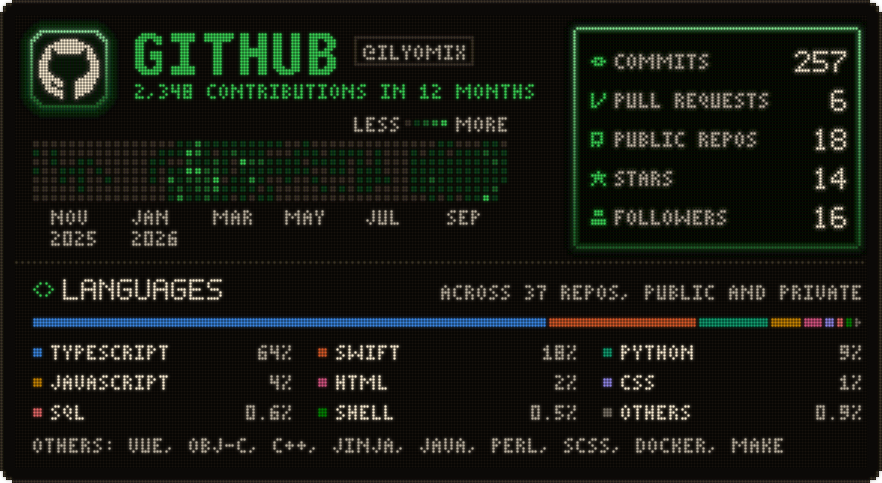</a>

<a href="https://ilyomix.github.io">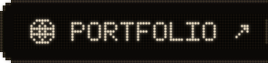</a><a href="mailto:ilyes1204@gmail.com">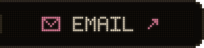</a>

<!-- The pet card: the scene on top is live from api/pet.py (one image); Feed, Pet, Play and the six-pet switch
below it are static slices from the build, so they load with the rest. Each slice links to api/act.py, which
records the click and comes straight back here. align="top" keeps the bands touching. -->

 <a href="https://ilyomix-profile.vercel.app/api/act?do=feed">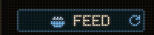</a><a href="https://ilyomix-profile.vercel.app/api/act?do=pet">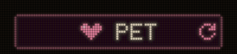</a><a href="https://ilyomix-profile.vercel.app/api/act?do=play">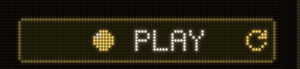</a> <a href="https://ilyomix-profile.vercel.app/api/act?do=choose&pet=cat">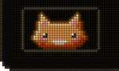</a><a href="https://ilyomix-profile.vercel.app/api/act?do=choose&pet=dog">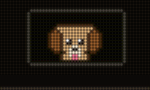</a><a href="https://ilyomix-profile.vercel.app/api/act?do=choose&pet=bunny">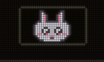</a><a href="https://ilyomix-profile.vercel.app/api/act?do=choose&pet=fox">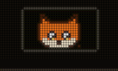</a><a href="https://ilyomix-profile.vercel.app/api/act?do=choose&pet=penguin">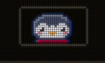</a><a href="https://ilyomix-profile.vercel.app/api/act?do=choose&pet=frog">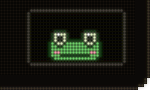</a>

