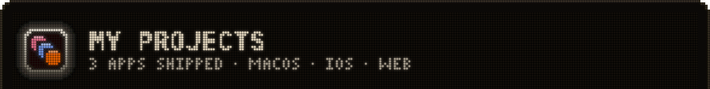
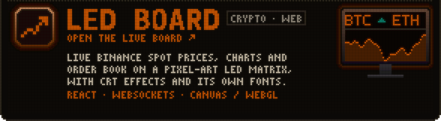
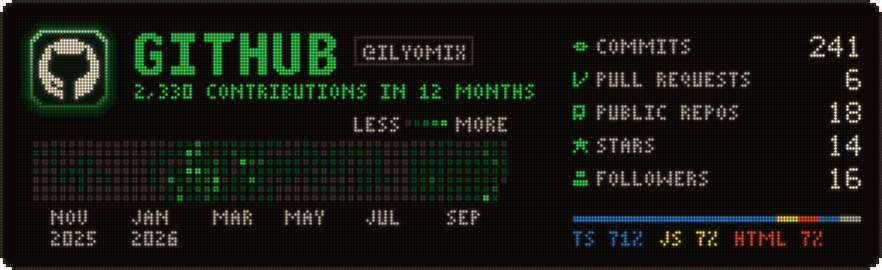
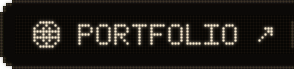
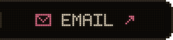

<!-- The projects as one card, in four bands that touch thanks to align="top": the heading and LED Board come
from the build, Cadran (live downloads, real-time Titan clock) and Lift (real-time lock screen) from api/. -->

   

<!-- The pet card, live from api/pet.py: Feed, Pet, Play over the five-pet switch, cut from one drawing. Each slice links to
api/act.py, which records the click and comes straight back here. align="top" keeps the two bands touching. -->

 

